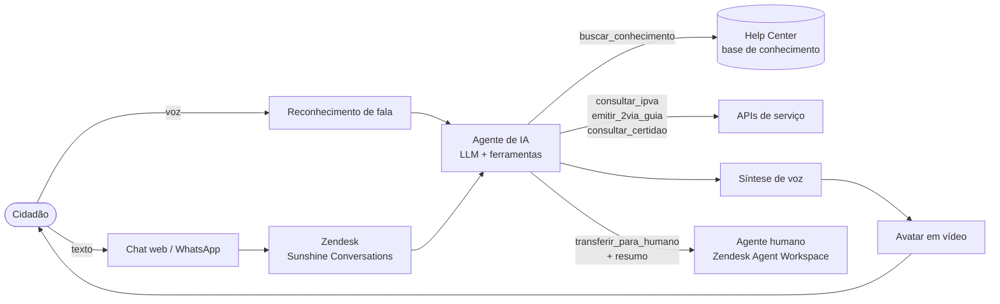
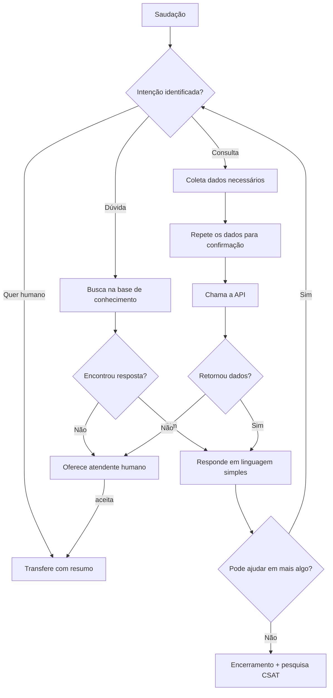

# Caso 01 — Atendente virtual com avatar (voz + texto)

> Cenário fictício e anonimizado, baseado em uma demonstração que projetei para atendimento ao cidadão em serviços tributários estaduais.

## Contexto e problema
O órgão recebe alto volume de dúvidas repetitivas sobre IPVA, guias de pagamento e certidões, além de contatos que exigem consulta a sistemas. O atendimento humano fica sobrecarregado e o cidadão repete o caso a cada transferência.

**Objetivo:** um atendente virtual com rosto e voz, disponível no portal, no Help Center e em totens. Ele resolve dúvidas e consultas simples sozinho e transfere para um humano **com o histórico e um resumo do caso**.

| Meta | Indicador |
|---|---|
| Resolver dúvidas frequentes sem humano | Taxa de contenção |
| Não fazer o cidadão repetir o caso | % de transbordos com resumo |
| Atendimento claro em voz | CSAT da conversa por voz |

## Persona: Atena
- **Papel:** atendente virtual de serviços públicos.
- **Tom:** cordial, claro e objetivo. Frases curtas, uma pergunta por vez.
- **Limites:** nunca inventa valores, prazos ou números. Na dúvida, oferece atendente humano.
- **Abertura:** "Olá, eu sou a Atena, atendente virtual. Como posso te ajudar hoje?"

## Arquitetura



- **Canais:** chat no portal, painel flutuante no Help Center, WhatsApp e totem com avatar.
- **Mesma conversa:** voz e texto ficam registrados na mesma conversa do Zendesk. O agente humano vê tudo.
- **Segurança:** credenciais ficam só no servidor; CPF, placa e Renavam são mascarados nos registros.

## Jornada principal



## Mapa de intenções

| Intenção | Exemplos de frase | Tipo | Ação |
|---|---|---|---|
| `duvida_ipva_pagamento` | "Como pago meu IPVA atrasado?" | Informativa | Base de conhecimento |
| `consultar_ipva` | "Quero ver se meu carro tem débito" | Transacional | Coleta placa + Renavam → API |
| `segunda_via_guia` | "Preciso da 2ª via da guia de ICMS" | Transacional | Coleta inscrição + tributo → API |
| `consultar_certidao` | "Tenho débitos no meu CPF?" | Transacional | Coleta CPF/CNPJ → API |
| `duvida_certidao` | "Como tiro a certidão negativa?" | Informativa | Base de conhecimento |
| `duvida_parcelamento` | "Dá para parcelar o débito?" | Informativa | Base de conhecimento |
| `ouvidoria` | "Quero fazer uma reclamação" | Informativa | Base de conhecimento |
| `falar_com_humano` | "Quero falar com uma pessoa" | Transbordo | Transfere com resumo |
| `fora_do_escopo` | "Qual o resultado do jogo?" | Fallback | Explica o escopo e oferece ajuda |

### Entidades
| Entidade | Formato | Validação |
|---|---|---|
| Placa | `ABC1D23` ou `ABC1234` | Padrão Mercosul ou antigo |
| Renavam | 11 dígitos | Somente números |
| CPF / CNPJ | 11 ou 14 dígitos | Somente números |
| Tributo | ICMS, IPVA, ITCD, Taxas | Lista fechada |

## Diálogos de exemplo

**1. Consulta com confirmação de dados (caminho feliz)**
> **Cidadão:** Quero consultar meu IPVA.
> **Atena:** Claro. Qual é a placa do veículo?
> **Cidadão:** ABC1D23.
> **Atena:** E o número do Renavam?
> **Cidadão:** 12345678901.
> **Atena:** Só para confirmar: placa A, B, C, um, D, dois, três e Renavam um, dois, três, quatro, cinco, seis, sete, oito, nove, zero, um. Está correto?
> **Cidadão:** Sim.
> **Atena:** Encontrei três parcelas em atraso, no total de mil duzentos e oitenta e quatro reais e cinquenta e cinco centavos. Quer que eu emita a guia para pagamento?

**2. Dado não encontrado**
> **Atena:** Não localizei esse veículo com os dados informados. Posso te encaminhar para um atendente, e ele recebe todo o histórico desta conversa. Quer que eu encaminhe?

**3. Transbordo para humano**
> **Cidadão:** Prefiro falar com uma pessoa.
> **Atena:** Tudo bem. Vou te encaminhar agora. O atendente já recebe o resumo do seu caso, então você não vai precisar repetir nada.

**Nota interna gerada para o agente:**
```
📋 Resumo da Atena
Intenção: consulta de IPVA
Resultado: 3 parcelas em atraso localizadas
Motivo da transferência: cidadão pediu atendimento humano
```

**4. Fora do escopo**
> **Cidadão:** Você sabe o horário do ônibus?
> **Atena:** Esse assunto não é atendido aqui. Eu ajudo com IPVA, guias de pagamento, certidões e ouvidoria. Posso te ajudar com algum desses?

## Regras de transbordo
| Gatilho | Comportamento |
|---|---|
| Cidadão pede atendimento humano | Transfere na hora, sem insistir |
| API não retorna o dado | Oferece humano; transfere se aceitar |
| Duas tentativas sem entender a intenção | Oferece humano |
| Assunto fora do escopo | Explica o escopo; oferece humano |
| Sempre | Envia **motivo + resumo** como nota interna; o cidadão não repete o caso |

## Guia de escrita para voz
- Números, valores e datas **por extenso**.
- Placa soletrada caractere por caractere; Renavam, CPF e CNPJ lidos algarismo por algarismo.
- Sem listas longas, siglas sem explicação, links ou formatação na fala.
- Uma pergunta por vez e sempre confirmar dados antes de consultar.

## Critérios de qualidade (roteiro de teste)
| Bloco | O que validar |
|---|---|
| Conhecimento | Respostas corretas e baseadas na base oficial, sem inventar valores |
| Consultas | Pede todos os dados, confirma antes de chamar a API, trata "não encontrado" |
| Bordas | Fora do escopo, pedido de humano, dados incompletos, tentativa de obter dados de terceiros |
| Voz | Latência da resposta, pronúncia de números e siglas, interrupções |

## Resultados esperados
- Dúvidas frequentes resolvidas sem atendente.
- Transferências chegando ao humano com contexto completo.
- Mesma experiência na voz, no chat e no WhatsApp.
