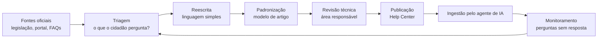

# Caso 02 — Curadoria de base de conhecimento para IA

> Cenário fictício e anonimizado, baseado em pipelines de artigos que estruturei para Help Centers de órgãos públicos.

## Problema
Agentes de IA generativa respondem tão bem quanto a base que consultam. A base de origem era composta por textos longos, linguagem jurídica, informações duplicadas e valores desatualizados. O resultado: respostas longas, imprecisas ou com prazos errados.

## Pipeline de curadoria



## Modelo padrão de artigo
1. **Título em forma de pergunta** do cidadão ("Como pagar o IPVA em atraso?").
2. **Resposta direta** nas duas primeiras frases.
3. **Passo a passo** numerado, quando houver.
4. **Informações do serviço**: quem pode pedir, documentos, prazo, custo.
5. **Alerta** para o que costuma gerar erro.
6. **Base legal** no final, para quem quiser consultar.

## Checklist de qualidade
| Critério | Por que importa para a IA |
|---|---|
| Um assunto por artigo | Evita que o agente misture respostas |
| Resposta nas primeiras frases | O trecho recuperado já contém a resposta |
| Sem valores e prazos que mudam todo ano | Evita respostas desatualizadas; aponta para a fonte oficial |
| Termos que o cidadão usa ("2ª via", "boleto") | Melhora a busca e a correspondência da pergunta |
| Sem duplicidade entre artigos | Evita respostas contraditórias |
| Revisado pela área técnica | Garante a precisão da resposta |

## Antes e depois

**Antes**
> Nos termos da legislação vigente, o contribuinte inadimplente quanto ao imposto sobre a propriedade de veículos automotores poderá proceder à regularização mediante emissão de documento de arrecadação, observados os acréscimos moratórios incidentes...

**Depois**
> **Como pagar o IPVA em atraso?**
> Você paga o IPVA em atraso pela mesma guia de pagamento, emitida na consulta por placa e Renavam. Os juros e a multa já vêm calculados na guia.
> 1. Acesse a consulta de IPVA e informe placa e Renavam.
> 2. Escolha a parcela ou o exercício em aberto.
> 3. Emita a guia e pague no banco, na lotérica ou pelo aplicativo do banco.
>
> ⚠ Valores e descontos mudam a cada ano. Confira sempre no portal oficial.

## Prompt do agente generativo (trecho)
```
Você é a atendente virtual de serviços públicos.
Responda SOMENTE com base nos artigos recuperados pela ferramenta buscar_conhecimento.
- Comece pela resposta direta, em até 3 frases curtas.
- Nunca invente valores, prazos ou números.
- Se o artigo não responder à pergunta, diga que não encontrou a informação
  e ofereça atendimento humano.
- Ao final, pergunte se pode ajudar em mais algo.
```

## Ciclo de melhoria contínua
| Sinal | Ação de curadoria |
|---|---|
| Pergunta sem artigo correspondente | Criar novo artigo |
| Resposta correta, mas CSAT baixo | Simplificar a linguagem |
| Transbordo frequente no mesmo tema | Revisar artigo ou criar fluxo transacional |
| Artigo com regra desatualizada | Revisar com a área técnica |
