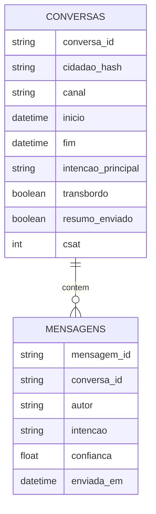

# Caso 03 — Métricas de experiência conversacional

> Especificação de indicadores e consultas para acompanhar um atendente virtual e orientar a evolução dos fluxos. Dados fictícios.

## Indicadores
| Indicador | Definição | Leitura |
|---|---|---|
| **Taxa de contenção** | Conversas resolvidas pela IA sem transbordo ÷ total de conversas | Quanto o bot resolve sozinho |
| **Taxa de transbordo** | Conversas transferidas para humano ÷ total | Alta em um tema = fluxo ou artigo a melhorar |
| **Transbordo com resumo** | Transbordos com nota de resumo ÷ total de transbordos | Cidadão não repete o caso |
| **Fallback** | Mensagens sem intenção reconhecida ÷ total de mensagens | Lacunas no mapa de intenções |
| **CSAT** | Média das notas da pesquisa ao fim da conversa (1 a 5) | Satisfação percebida |
| **FCR** | Conversas sem novo contato do mesmo cidadão em 7 dias ÷ total | Resolução no primeiro contato |
| **Tempo médio de resolução** | Duração média das conversas resolvidas | Eficiência do fluxo |

## Modelo de dados



## Consultas SQL

**Contenção, transbordo e CSAT por canal**
```sql
SELECT
  canal,
  COUNT(*)                                                    AS conversas,
  ROUND(100.0 * AVG(CASE WHEN NOT transbordo THEN 1 ELSE 0 END), 1) AS contencao_pct,
  ROUND(100.0 * AVG(CASE WHEN transbordo THEN 1 ELSE 0 END), 1)     AS transbordo_pct,
  ROUND(AVG(csat), 2)                                         AS csat_medio
FROM conversas
WHERE inicio >= CURRENT_DATE - INTERVAL '30 days'
GROUP BY canal
ORDER BY conversas DESC;
```

**Intenções que mais geram transbordo**
```sql
SELECT
  intencao_principal,
  COUNT(*) AS conversas,
  ROUND(100.0 * AVG(CASE WHEN transbordo THEN 1 ELSE 0 END), 1) AS transbordo_pct
FROM conversas
GROUP BY intencao_principal
HAVING COUNT(*) >= 30
ORDER BY transbordo_pct DESC
LIMIT 10;
```

**Taxa de fallback por semana**
```sql
SELECT
  DATE_TRUNC('week', enviada_em) AS semana,
  ROUND(100.0 * AVG(CASE WHEN intencao = 'fallback' THEN 1 ELSE 0 END), 1) AS fallback_pct
FROM mensagens
WHERE autor = 'cidadao'
GROUP BY semana
ORDER BY semana;
```

**FCR: sem novo contato em 7 dias**
```sql
SELECT
  ROUND(100.0 * AVG(CASE WHEN prox.conversa_id IS NULL THEN 1 ELSE 0 END), 1) AS fcr_pct
FROM conversas c
LEFT JOIN conversas prox
  ON  prox.cidadao_hash = c.cidadao_hash
  AND prox.inicio >  c.fim
  AND prox.inicio <= c.fim + INTERVAL '7 days';
```

## Como os números orientam a evolução
| Achado | Decisão |
|---|---|
| Intenção com transbordo acima de 40% | Revisar o fluxo ou criar ferramenta transacional |
| Fallback subindo | Novas frases de treino ou novas intenções |
| CSAT baixo com boa contenção | Revisar linguagem e tamanho das respostas |
| FCR baixo em um tema | Resposta incompleta: revisar artigo da base |

## Análise em Python (especificação)
Um notebook lê as tabelas acima, calcula os indicadores por semana e por canal e gera:
- gráfico de linha da contenção e do CSAT ao longo do tempo;
- ranking das intenções com mais transbordo;
- lista das perguntas sem intenção reconhecida, para a curadoria.
